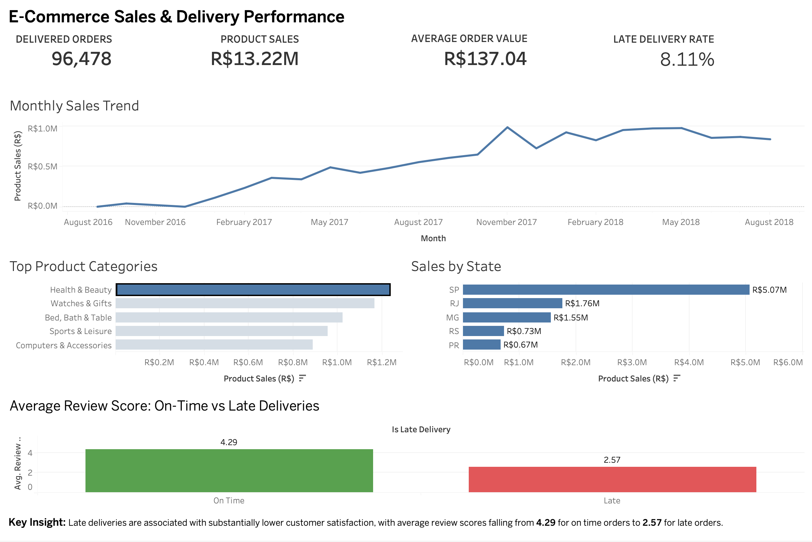

# E-Commerce Sales Analysis

End-to-end e-commerce analysis using **Python, SQL, SQLite and Tableau**.

The project uses the **Brazilian E-Commerce Public Dataset by Olist** and covers data cleaning, database creation, business analysis and dashboard development.

## Dashboard



### Key KPIs

- **96,478** delivered orders
- **R$13.22M** product sales
- **R$137.04** average order value
- **8.11%** late delivery rate

## Key Insights

- On-time deliveries had an average review score of **4.29 / 5**, compared with **2.57 / 5** for late deliveries.
- **São Paulo (SP)** was the largest market, generating approximately **R$5.07M** in product sales.
- Top-selling categories included **Health & Beauty**, **Watches & Gifts**, and **Bed, Bath & Table**.

## What I Did

- Cleaned and transformed raw e-commerce data using **Python and pandas**
- Validated data quality and table relationships
- Built a **SQLite relational database**
- Used **SQL** to analyse sales, customers, products and delivery performance
- Created a **Tableau dashboard** to present the main business KPIs and trends

## Tools

**Python · pandas · SQL · SQLite · Tableau · Git · GitHub**

## Project Structure

```text
├── Tableau/
├── data/
│   ├── raw/
│   └── processed/
├── images/
├── scripts/
├── sql/
├── README.md
└── LICENSE
```

## Run the Project

Place the original dataset in:

```text
data/raw/
```

Then run:

```bash
python scripts/data_quality_audit.py
python scripts/prepare_data.py
python scripts/validate_processed_data.py
python scripts/create_database.py
```

The main SQL analysis is available in:

```text
sql/business_queries.sql
```

The Tableau workbook is available in:

```text
Tableau/ecommerce_sales_dashboard.twbx
```

## Dataset

Brazilian E-Commerce Public Dataset by Olist.
